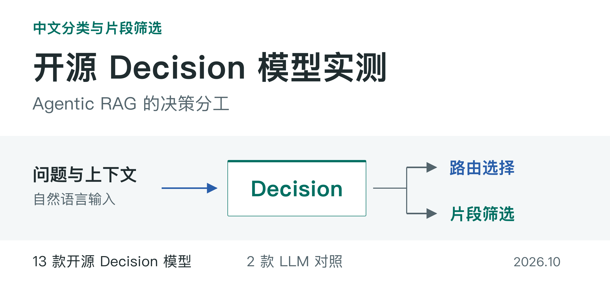
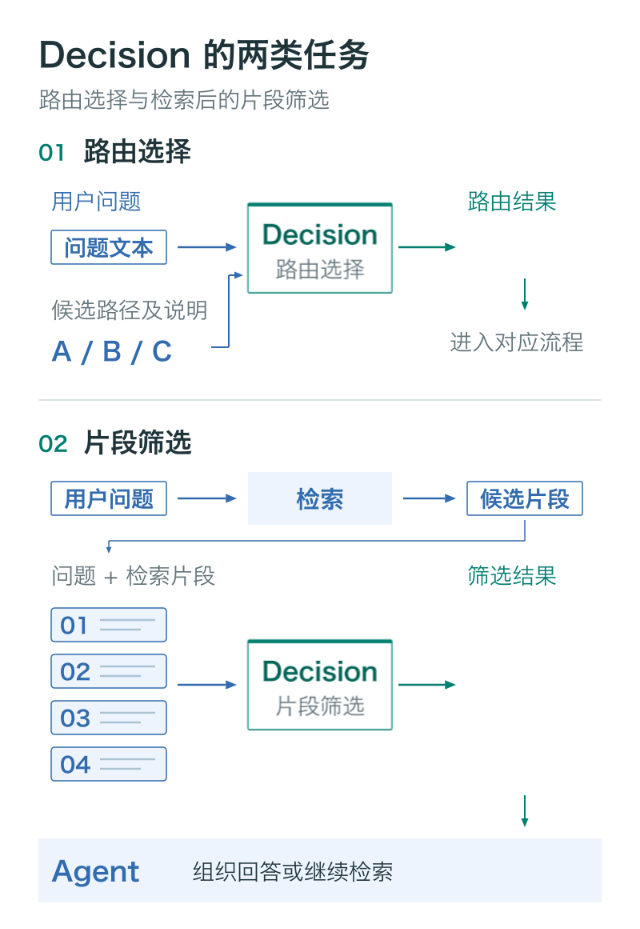
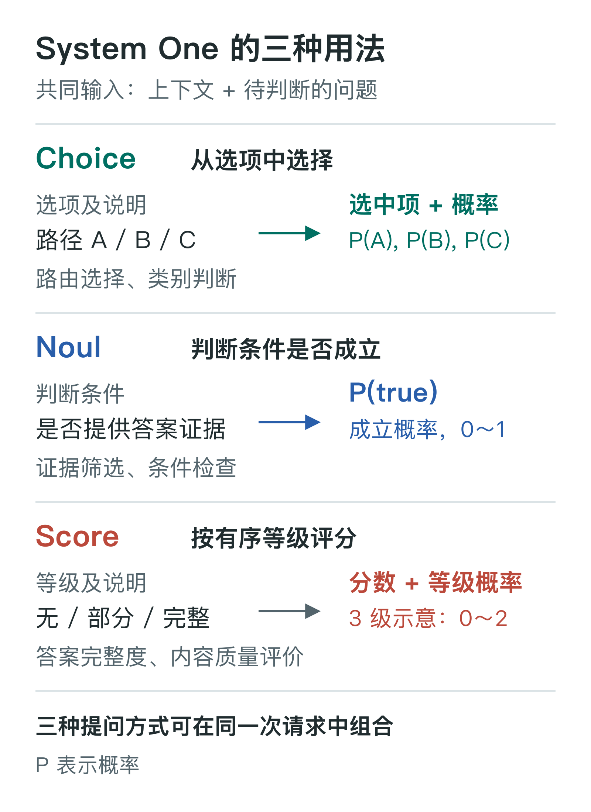

# 开源 Decision 模型实测

[TypeSafe Jev](https://docs.typesafe.ai/concepts/system-one) 的出现，让「把高频判断交给专用模型」成为一个可选项——而在 Agentic RAG 中，这类判断与决策至关重要。

Jev 面向软件中的决策任务：接收上下文和自然语言问题，输出选项概率或真假评分，供程序据此作出决策。TypeSafe 将这类模型称为 System One，并提供 Choice、Noul、Score 等接口，分别用于选项评分、真假评分和分级评分。

这类模型将自然语言描述的条件与结构化评分结合，使不同的分类与判断任务能够采用相似的调用方式。路由选择可以采用概率最高的路径，证据筛选可以依据候选匹配概率和预设规则决定保留哪些片段。通用 LLM 通过结构化输出也能完成这些工作，因此有必要比较专用模型与通用 LLM 的判断质量和请求延迟。

在 Agentic RAG 中，可以由专用模型承担路由选择和检索片段筛选，Agent 负责规划、信息综合与回答。私有化项目要求数据不出内网，这类判断必须本地完成，不能调用外部 Decision API。

本文以两款通用 LLM 为对照，部署 13 款开源 Decision 模型，测试其中文分类与答案证据筛选能力，并记录判断质量与端到端请求耗时。

## Agentic RAG 中的决策分工

Agentic RAG 中，Agent 根据任务制定计划、调用工具，并依据已有材料决定继续检索或生成回答。这一过程既包含跨步骤推理，也包含重复执行的分类与筛选。

规划需要完整的任务上下文；路由选择与片段筛选的输入范围相对有限，输出格式也可以预先约定，适合由独立的决策服务处理。

**路由选择。** 输入包括用户问题、候选路径及其适用条件。Decision 模型对候选路径评分，上层程序据此将请求分派至对应流程。计划生成、工具参数构造与多步执行仍由 Agent 负责。

**检索后的片段筛选。** 根据用户问题检索得到候选片段后，Decision 模型评估片段是否提供答案证据。程序据此保留或排除片段，再将筛选结果交给 Agent，由其组织回答或继续检索。

*图 1：路由选择与片段筛选的功能流程。路径 B 与片段保留状态仅作示意，不代表实测结果。*

路由与筛选独立部署后，可以分别选择模型、记录质量指标，并按请求量配置资源。这些决策服务也可与回答生成服务分别配置：片段筛选通常涉及多次简短判断，回答生成则需要较长的文本输出。

片段评分用于筛选候选材料，Agent 则结合完整上下文判断材料是否足以回答问题，并处理跨文档互补和证据冲突。

[TypeSafe 官方的 RAG 示例](https://docs.typesafe.ai/cookbooks/classifying_rag_passages) 采用了类似分工：在检索与生成之间，分别判断片段的相关性、可用证据和冲突等属性，再组织回答所需的材料。本次测试聚焦其中的答案证据二分类。

## 私有化部署与测试范围

在要求数据不出内网的私有化项目中，问题分类、检索、片段筛选和回答生成都要在内网完成。仅部署本地回答模型并不足够，中间环节调用外部服务仍会传输数据。开源 Decision 模型则可以在内网承担这些判断。

测试覆盖 D3、Vela 系列，以及 Clef-Flash、Laya、NeoHorse-Jev、Jeva、AutoTrust JEV-27B 和 PPLX-Decider，共 13 款模型。它们的规模、训练方法和推理实现不同，本文以“Decision”概括其任务类型，不将它们视为同一种架构。

其中，[AutoTrust JEV-27B](https://huggingface.co/autotrust/JEV-27B) 是独立团队发布的开放权重模型，与 TypeSafe Jev 并非同一产品。**本文未测试 TypeSafe Jev API**，下文结果均来自本地部署的开源模型及 LLM 对照。

两项测试分别考察：

- **中文分类**：将每条输入归入 18 个领域类别之一，评估路由所需的类别判断能力。
- **片段筛选**：根据问题与检索片段评估答案证据，统计保留、误收和漏选情况。

分类测试对应路由中的基础判断，不包含完整的工具选择与任务规划。片段测试采用两种原生接口：**choice** 显式提供“有答案证据”和“无答案证据”两个选项，返回各选项概率及选中的选项；**noul** 不提供这两个自定义选项，对“是否提供答案证据”进行真假评分，返回成立概率或原生的是非判断结果。

*图 2：两种接口的评分形式。A、B 为选项示意，P 表示模型输出概率。部分实现还会同时返回选中的选项或布尔结果。*

对比两种接口，是为了观察同一模型采用不同的选项表达和判定方式时，筛选结果有何差异。choice、noul 是接口形式，与思考／非思考模式无关。片段筛选表包含全部 28 个模式：13 款开源 Decision 模型各测 choice、noul，两款 LLM 各测非思考的 choice。

## 分类：准确率与请求延迟

分类测试采用 MASSIVE v1.1 中文测试集，共 2,974 条输入、18 个类别。下表列出全部 16 个配置，含 Qwen3.8 的思考与非思考对照；每个配置均完成全部 2,974 条输入的测试。

表中的两项质量指标分别衡量整体正确率与各类别的分类表现：

- **Accuracy（准确率）**：全部测试输入中，类别判断正确的比例。它反映整体分类效果，样本较多的类别对结果影响更大。
- **macro-F1（宏平均 F1）**：先为每个类别计算 F1，再对 18 个类别等权取平均。对某一类别，精确率衡量“被分到该类的输入中，有多少确实属于该类”，召回率衡量“本属该类的输入中，有多少被正确识别”；F1 综合这两项指标。等权平均使样本较少的类别同样重要，避免其表现被大类别掩盖。

两项质量指标均以百分比表示，越高越好。平均延迟与 P99 按有效请求统计，单位为毫秒，越低越好。

**表 1：中文分类结果 · 16 个配置**

<table><thead><tr><th align="center">分组</th><th align="left">模型 / 配置</th><th align="right">Accuracy (%)</th><th align="right">macro-F1 (%)</th><th align="right">平均延迟 (ms)</th><th align="right">P99 (ms)</th></tr>
</thead><tbody><tr><th rowspan="4" scope="rowgroup" align="center">小于 1B</th><td align="left">D3-edge</td><td align="right">82.72</td><td align="right">82.78</td><td align="right">26.64</td><td align="right">27.83</td></tr>
<tr><td align="left">Vela 2.0-0.8B</td><td align="right">81.67</td><td align="right">81.64</td><td align="right">84.03</td><td align="right">87.28</td></tr>
<tr><td align="left">Vela 2.0-0.3B</td><td align="right">77.91</td><td align="right">77.81</td><td align="right">15.37</td><td align="right">16.45</td></tr>
<tr><td align="left">Laya Multilingual</td><td align="right">61.23</td><td align="right">60.85</td><td align="right">29.31</td><td align="right">31.19</td></tr>
</tbody><tbody><tr><th rowspan="4" scope="rowgroup" align="center">4B</th><td align="left">D3-mini</td><td align="right">88.77</td><td align="right">88.04</td><td align="right">69.92</td><td align="right">72.83</td></tr>
<tr><td align="left">Vela 2.0-4B</td><td align="right">86.99</td><td align="right">86.98</td><td align="right">111.94</td><td align="right">115.08</td></tr>
<tr><td align="left">NeoHorse-Jev-4B</td><td align="right">85.14</td><td align="right">84.98</td><td align="right">596.67</td><td align="right">626.26</td></tr>
<tr><td align="left">Jeva-4B（串行参考）</td><td align="right">80.60</td><td align="right">79.74</td><td align="right">205.62</td><td align="right">212.62</td></tr>
</tbody><tbody><tr><th rowspan="3" scope="rowgroup" align="center">9B</th><td align="left">Clef-Flash</td><td align="right">91.69</td><td align="right">91.36</td><td align="right">71.84</td><td align="right">76.05</td></tr>
<tr><td align="left">D3-flash</td><td align="right">89.64</td><td align="right">89.35</td><td align="right">71.20</td><td align="right">73.74</td></tr>
<tr><td align="left">Vela 2.0-9B</td><td align="right">86.79</td><td align="right">87.22</td><td align="right">112.73</td><td align="right">116.87</td></tr>
</tbody><tbody><tr><th rowspan="2" scope="rowgroup" align="center">27B</th><td align="left">PPLX-Decider-v1.1-27B</td><td align="right">91.90</td><td align="right">91.43</td><td align="right">204.08</td><td align="right">230.25</td></tr>
<tr><td align="left">JEV-27B</td><td align="right">85.74</td><td align="right">85.21</td><td align="right">277.24</td><td align="right">288.28</td></tr>
</tbody><tbody><tr><th rowspan="3" scope="rowgroup" align="center">LLM 基线</th><td align="left">Qwen3-30B-A3B-Instruct-2507</td><td align="right">83.69</td><td align="right">82.92</td><td align="right">145.37</td><td align="right">155.55</td></tr>
<tr><td align="left">Qwen3.8-27B 非思考</td><td align="right">88.03</td><td align="right">87.04</td><td align="right">355.49</td><td align="right">380.56</td></tr>
<tr><td align="left">Qwen3.8-27B 思考 xhigh</td><td align="right">87.63</td><td align="right">86.88</td><td align="right">3124.02</td><td align="right">12069.45</td></tr>
</tbody></table>

Clef-Flash 在单张 A100 上取得 **91.69%** 的准确率，平均请求延迟为 **71.84 ms**。双卡部署的 PPLX-Decider 准确率为 91.90%，正确分类的输入比 Clef-Flash 多 6 条，平均延迟为 204.08 ms。在上述部署配置下，Clef-Flash 使用更少的 GPU 达到了接近的分类质量。

D3-mini 的准确率为 **88.77%**，平均延迟为 **69.92 ms**；D3-flash 分别为 **89.64%** 和 **71.20 ms**。两者延迟接近，D3-flash 的准确率略高。D3-mini 则提供了一个 4B 规模的部署选择。

Qwen3.8 开启思考后，平均延迟从 355.49 ms 增至 3,124.02 ms，约为原来的 8.8 倍，本次测试未显示出明确的分类质量提升。

延迟按单次请求测量，包含通信与解析。由于部署引擎和 GPU 数量不同，此处比较的是实际配置表现，无法据此推算并发吞吐量。

## 片段筛选：证据保留与噪声过滤

检索结果与问题主题相关，并不意味着其中包含回答所需的信息。片段筛选进一步判断内容是否提供答案证据。

测试采用 T2Ranking。它按照片段对问题的信息需求满足程度划分等级：L0 表示不匹配；L1 表示主题相关，但不满足信息需求；L2 表示相关，并部分满足信息需求；L3 表示满足信息需求，且明确包含答案。

**L2 不等于只有主题关联，也可能提供部分答案。** 本次提示允许保留部分答案，因此原测试将 L2/L3 作为正例，L0/L1 作为负例。为区分答案保留与无效内容过滤，下文分别报告四个等级的结果，不将 L2 的保留视为误收。

正式测试采用其中的 **197 个问题、3,054 个片段**，含正例 924 个、负例 2,130 个；本轮以“完整问题 + 单个完整片段”为一次评测输入，不截断内容。

choice 直接采用接口选中的选项；noul 优先采用接口返回的是非判断结果。若 noul 仅返回数值型成立概率，则比较 true（有答案证据）与 false（无答案证据）的概率，选择概率较高的一项，同分记为 false。这相当于成立概率大于 0.5 时保留片段。

评价重点是：**保住答案的同时，能过滤多少无效内容。** 表 2 将这两方面分开呈现：

- **L3 保留率**：181 个 L3 片段中，被保留下来的比例，衡量直接答案片段的保留情况。
- **L2 保留率**：743 个 L2 片段中，被保留下来的比例，反映部分答案信息的保留情况。
- **L1 过滤率、L0 过滤率**：分别在 451 个 L1 和 1,679 个 L0 片段中，被排除的比例，衡量对主题相关但无效内容、以及不匹配内容的过滤效果。
- **有 L3 问题命中率**：101 个原本含 L3 的问题中，筛选后至少保留一条 L3 的问题比例。其余 96 个问题没有 L3，但仍可能有可用的 L2，不应直接视为没有答案信息。
- **每题保留片段数**：保留总数除以全部 197 个问题。筛选前平均每题有 15.50 个片段；保留数量需与答案保留情况一起比较，并非越少越好。

前五项比例均为越高越好。分级保留率与过滤率按各等级的全部片段计算，不是保留结果中的构成比例；问题命中率按问题计算。表格保留全部 28 个模式，并按模型规模分组，不按某一项指标重新排名。这些是原生预测的分级统计，没有改变提示、判定规则或测试样本。

表中同时列出平均延迟、P99 和每个问题平均耗时。前两项对应一次片段判断，后一项对应筛完该问题全部候选片段的实测总耗时，单位均为毫秒，包含通信、推理和结果检查，不含模型加载。质量与耗时应一起比较，不能用保留片段数的减少直接推算筛选环节的提速。

**表 2：分级筛选与耗时 · 28 个模式**

<table><thead><tr><th scope="col" align="center">分组</th><th scope="col" align="left">模型 / 模式</th><th scope="col" align="right">L3 保留率 (%)</th><th scope="col" align="right">L2 保留率 (%)</th><th scope="col" align="right">L1 过滤率 (%)</th><th scope="col" align="right">L0 过滤率 (%)</th><th scope="col" align="right">有 L3 问题 命中率 (%)</th><th scope="col" align="right">每题保留 片段数</th><th scope="col" align="right">平均延迟 (ms)</th><th scope="col" align="right">P99 (ms)</th><th scope="col" align="right">每个问题 平均耗时 (ms)</th></tr>
</thead><tbody><tr><th scope="rowgroup" rowspan="8" align="center">小于 1B</th><td align="left">D3-edge choice</td><td align="right">62.98</td><td align="right">52.22</td><td align="right">62.53</td><td align="right">76.35</td><td align="right">72.28</td><td align="right">5.42</td><td align="right">29.88</td><td align="right">54.46</td><td align="right">584.97</td></tr>
<tr><td align="left">D3-edge noul</td><td align="right">58.56</td><td align="right">50.34</td><td align="right">63.41</td><td align="right">78.14</td><td align="right">66.34</td><td align="right">5.14</td><td align="right">29.91</td><td align="right">57.44</td><td align="right">578.32</td></tr>
<tr><td align="left">Vela 2.0-0.3B choice</td><td align="right">86.74</td><td align="right">90.58</td><td align="right">14.19</td><td align="right">25.91</td><td align="right">92.08</td><td align="right">12.49</td><td align="right">22.68</td><td align="right">100.69</td><td align="right">454.74</td></tr>
<tr><td align="left">Vela 2.0-0.3B noul</td><td align="right">17.68</td><td align="right">15.48</td><td align="right">90.91</td><td align="right">92.26</td><td align="right">24.75</td><td align="right">1.61</td><td align="right">22.90</td><td align="right">101.99</td><td align="right">464.47</td></tr>
<tr><td align="left">Vela 2.0-0.8B choice</td><td align="right">96.69</td><td align="right">91.66</td><td align="right">9.31</td><td align="right">30.55</td><td align="right">98.02</td><td align="right">12.34</td><td align="right">85.45</td><td align="right">95.40</td><td align="right">1448.31</td></tr>
<tr><td align="left">Vela 2.0-0.8B noul</td><td align="right">88.95</td><td align="right">81.56</td><td align="right">24.83</td><td align="right">46.75</td><td align="right">92.08</td><td align="right">10.15</td><td align="right">85.50</td><td align="right">95.76</td><td align="right">1459.89</td></tr>
<tr><td align="left">Laya Multilingual choice</td><td align="right">55.80</td><td align="right">42.93</td><td align="right">65.85</td><td align="right">81.42</td><td align="right">67.33</td><td align="right">4.50</td><td align="right">28.02</td><td align="right">56.10</td><td align="right">557.98</td></tr>
<tr><td align="left">Laya Multilingual noul</td><td align="right">68.51</td><td align="right">55.59</td><td align="right">49.89</td><td align="right">66.29</td><td align="right">77.23</td><td align="right">6.75</td><td align="right">28.05</td><td align="right">57.01</td><td align="right">556.07</td></tr>
</tbody><tbody><tr><th scope="rowgroup" rowspan="8" align="center">4B</th><td align="left">D3-mini choice</td><td align="right">87.29</td><td align="right">72.95</td><td align="right">47.45</td><td align="right">67.96</td><td align="right">85.15</td><td align="right">7.49</td><td align="right">77.82</td><td align="right">243.82</td><td align="right">1339.72</td></tr>
<tr><td align="left">D3-mini noul</td><td align="right">86.74</td><td align="right">72.54</td><td align="right">47.01</td><td align="right">68.02</td><td align="right">85.15</td><td align="right">7.47</td><td align="right">77.83</td><td align="right">243.84</td><td align="right">1332.78</td></tr>
<tr><td align="left">Vela 2.0-4B choice</td><td align="right">87.85</td><td align="right">79.14</td><td align="right">36.14</td><td align="right">58.01</td><td align="right">89.11</td><td align="right">8.83</td><td align="right">117.37</td><td align="right">248.23</td><td align="right">1955.82</td></tr>
<tr><td align="left">Vela 2.0-4B noul</td><td align="right">84.53</td><td align="right">72.01</td><td align="right">49.22</td><td align="right">64.74</td><td align="right">87.13</td><td align="right">7.66</td><td align="right">117.48</td><td align="right">249.40</td><td align="right">1957.61</td></tr>
<tr><td align="left">NeoHorse-Jev-4B choice</td><td align="right">91.16</td><td align="right">79.41</td><td align="right">39.69</td><td align="right">55.57</td><td align="right">91.09</td><td align="right">9.00</td><td align="right">1066.52</td><td align="right">6624.51</td><td align="right">16683.04</td></tr>
<tr><td align="left">NeoHorse-Jev-4B noul</td><td align="right">91.71</td><td align="right">77.52</td><td align="right">38.36</td><td align="right">55.69</td><td align="right">93.07</td><td align="right">8.95</td><td align="right">1046.17</td><td align="right">6645.67</td><td align="right">16370.33</td></tr>
<tr><td align="left">Jeva-4B choice</td><td align="right">40.33</td><td align="right">31.76</td><td align="right">86.47</td><td align="right">93.39</td><td align="right">46.53</td><td align="right">2.44</td><td align="right">145.54</td><td align="right">294.01</td><td align="right">2403.99</td></tr>
<tr><td align="left">Jeva-4B noul</td><td align="right">41.44</td><td align="right">32.71</td><td align="right">85.14</td><td align="right">92.02</td><td align="right">47.52</td><td align="right">2.63</td><td align="right">145.84</td><td align="right">294.90</td><td align="right">2409.99</td></tr>
</tbody><tbody><tr><th scope="rowgroup" rowspan="6" align="center">9B</th><td align="left">D3-flash choice</td><td align="right">85.08</td><td align="right">70.66</td><td align="right">49.67</td><td align="right">69.68</td><td align="right">84.16</td><td align="right">7.18</td><td align="right">89.43</td><td align="right">377.26</td><td align="right">1536.60</td></tr>
<tr><td align="left">D3-flash noul</td><td align="right">83.98</td><td align="right">69.45</td><td align="right">51.00</td><td align="right">70.52</td><td align="right">84.16</td><td align="right">7.03</td><td align="right">89.21</td><td align="right">373.72</td><td align="right">1523.43</td></tr>
<tr><td align="left">Clef-Flash choice</td><td align="right">83.98</td><td align="right">66.08</td><td align="right">52.77</td><td align="right">71.89</td><td align="right">81.19</td><td align="right">6.74</td><td align="right">83.50</td><td align="right">304.81</td><td align="right">1423.45</td></tr>
<tr><td align="left">Clef-Flash noul</td><td align="right">78.45</td><td align="right">58.68</td><td align="right">58.76</td><td align="right">75.04</td><td align="right">76.24</td><td align="right">6.01</td><td align="right">83.74</td><td align="right">303.77</td><td align="right">1431.40</td></tr>
<tr><td align="left">Vela 2.0-9B choice</td><td align="right">91.16</td><td align="right">76.18</td><td align="right">41.69</td><td align="right">59.98</td><td align="right">92.08</td><td align="right">8.46</td><td align="right">124.76</td><td align="right">382.91</td><td align="right">2065.92</td></tr>
<tr><td align="left">Vela 2.0-9B noul</td><td align="right">87.85</td><td align="right">70.12</td><td align="right">50.11</td><td align="right">65.99</td><td align="right">89.11</td><td align="right">7.49</td><td align="right">124.98</td><td align="right">384.46</td><td align="right">2085.35</td></tr>
</tbody><tbody><tr><th scope="rowgroup" rowspan="4" align="center">27B</th><td align="left">JEV-27B choice</td><td align="right">93.37</td><td align="right">80.22</td><td align="right">40.13</td><td align="right">58.37</td><td align="right">92.08</td><td align="right">8.80</td><td align="right">395.69</td><td align="right">1801.48</td><td align="right">6283.99</td></tr>
<tr><td align="left">JEV-27B noul</td><td align="right">92.27</td><td align="right">78.87</td><td align="right">42.79</td><td align="right">61.41</td><td align="right">91.09</td><td align="right">8.42</td><td align="right">394.04</td><td align="right">1799.46</td><td align="right">6262.86</td></tr>
<tr><td align="left">PPLX-Decider-v1.1-27B choice</td><td align="right">93.37</td><td align="right">77.93</td><td align="right">42.57</td><td align="right">65.34</td><td align="right">91.09</td><td align="right">8.07</td><td align="right">329.76</td><td align="right">1684.17</td><td align="right">5269.62</td></tr>
<tr><td align="left">PPLX-Decider-v1.1-27B noul</td><td align="right">91.71</td><td align="right">76.72</td><td align="right">44.79</td><td align="right">68.37</td><td align="right">90.10</td><td align="right">7.70</td><td align="right">327.10</td><td align="right">1659.26</td><td align="right">5223.53</td></tr>
</tbody><tbody><tr><th scope="rowgroup" rowspan="2" align="center">LLM 基线</th><td align="left">Qwen3-30B-A3B-Instruct-2507 非思考 / choice</td><td align="right">98.34</td><td align="right">96.10</td><td align="right">4.43</td><td align="right">7.50</td><td align="right">99.01</td><td align="right">14.60</td><td align="right">209.58</td><td align="right">594.72</td><td align="right">3388.97</td></tr>
<tr><td align="left">Qwen3.8-27B 非思考 / choice</td><td align="right">72.93</td><td align="right">60.03</td><td align="right">63.86</td><td align="right">77.78</td><td align="right">71.29</td><td align="right">5.65</td><td align="right">646.47</td><td align="right">1962.09</td><td align="right">10311.25</td></tr>
</tbody></table>

**三款重点模型体现了不同的筛选取舍。** D3-mini、D3-flash、Clef-Flash 在 choice 模式下，L3 保留率分别为 **87.29%**、**85.08%**、**83.98%**，L2 保留率分别为 72.95%、70.66%、66.08%。合并 L0/L1 后，三者过滤了 63.62%、65.45%、67.84% 的标注负例。D3-mini 保留的答案信息更多，Clef-Flash 过滤更严格，D3-flash 位于两者之间；分类准确率不能直接代替筛选效果。

在 101 个含 L3 的问题中，三者分别有 **86、85、82 个问题**在筛选后仍保留至少一条 L3；平均每题保留量从 15.50 条降至 **7.49、7.18、6.74 条**。这说明它们能够减少后续需要处理的片段数量，同时保住大部分直接答案片段。不过，命中一条 L3 不等于已覆盖问题的全部要点，也不等于最终回答正确。

D3-mini、D3-flash、Clef-Flash 的 choice 模式平均单次延迟分别为 **77.82、89.43、83.50 ms**；每个问题的平均筛选耗时分别为 **1,339.72、1,536.60、1,423.45 ms**。这些是相同候选范围下的串行实测耗时，不代表并发吞吐量。

**高保留率需要与过滤率一起看。** Qwen3-30B-A3B 保留了 98.34% 的 L3 和 96.10% 的 L2，但仅过滤 4.43% 的 L1、7.50% 的 L0，平均每题仍保留 14.60 条。相反，Jeva-4B 的 choice 模式过滤了 86.47% 的 L1、93.39% 的 L0，但 L3 保留率只有 40.33%。两者分别体现了偏向保留和偏向拒收的代价，不能只凭一列数值判断优劣。

**choice 与 noul 也应按相同标准比较。** D3-mini 两种模式的结果接近；Clef-Flash 改用 noul 后，L1 过滤率从 52.77% 提高到 58.76%，L3 保留率则从 83.98% 降至 78.45%。接口变化可能改变保留与过滤的取舍，并非固定带来质量提升。

分级结果表明，三款重点模型对 L3 的保留率高于 L2，对 L0 的过滤率高于 L1。区分“主题相关”与“确实提供答案信息”仍有改进空间。L2 可能包含部分答案，不宜为了减少片段数量而统一排除；后续优化应同时观察 L3、L2 的损失与 L0/L1 的过滤收益，而不是只追求更高召回率或更少保留量。

补充：精确率、召回率、F1 与请求耗时

原测试的合并指标与耗时保留在表 3，数值和统计口径均未改变。它们衡量与 L2/L3 正例集合的一致程度，作为分级结果的补充，而非答案是否足够或最终问答质量的评分。

- **Precision（精确率）**：保留的片段中，标注为有答案证据的比例。越高，表示保留结果中无证据片段的占比越低。
- **Recall（召回率）**：所有标注为有答案证据的片段中，被模型保留下来的比例。越高，表示遗漏的证据越少。
- **F1**：精确率与召回率的调和平均，用于综合衡量误收与漏选。只有两者都较高，F1 才会高；它不是“判断正确的片段占比”。
- **95% 置信区间**：F1 后方括号中的范围，通过对测试问题进行重采样估计，反映有限样本带来的统计不确定性，不代表模型输出的置信度。表 2 的分级比例是点估计，不能借用此 F1 区间判断其差异是否显著。

表中的 Precision、Recall 和 F1 均先按问题计算，再对 183 个含证据问题等权取平均，避免候选片段多的问题占据更大权重。因此，表中 F1 不能由表中的平均 Precision 和平均 Recall 直接算出。

平均延迟与 P99 对应一次片段判断；每个问题平均耗时对应筛完该问题全部候选片段的平均总耗时。三项均以毫秒计，包含通信、推理和结果检查，不含模型加载。

**表 3：L2/L3 合并指标与耗时 · 28 个模式**

<table><thead><tr><th scope="col" align="center">分组</th><th scope="col" align="left">模型 / 模式</th><th scope="col" align="right">Precision (%)</th><th scope="col" align="right">Recall (%)</th><th scope="col" align="right">F1 (%) <small>[95% 置信区间]</small></th><th scope="col" align="right">平均延迟 (ms)</th><th scope="col" align="right">P99 (ms)</th><th scope="col" align="right">每个问题 平均耗时 (ms)</th></tr>
</thead><tbody><tr><th scope="rowgroup" rowspan="8" align="center">小于 1B</th><td align="left">D3-edge choice</td><td align="right">40.12</td><td align="right">50.78</td><td align="right">39.81 [35.63, 43.99]</td><td align="right">29.88</td><td align="right">54.46</td><td align="right">584.97</td></tr>
<tr><td align="left">D3-edge noul</td><td align="right">39.75</td><td align="right">47.78</td><td align="right">38.32 [34.25, 42.72]</td><td align="right">29.91</td><td align="right">57.44</td><td align="right">578.32</td></tr>
<tr><td align="left">Vela 2.0-0.3B choice</td><td align="right">35.79</td><td align="right">86.03</td><td align="right">46.43 [43.00, 49.89]</td><td align="right">22.68</td><td align="right">100.69</td><td align="right">454.74</td></tr>
<tr><td align="left">Vela 2.0-0.3B noul</td><td align="right">23.61</td><td align="right">13.26</td><td align="right">14.71 [11.39, 18.05]</td><td align="right">22.90</td><td align="right">101.99</td><td align="right">464.47</td></tr>
<tr><td align="left">Vela 2.0-0.8B choice</td><td align="right">36.62</td><td align="right">89.85</td><td align="right">48.40 [45.01, 51.76]</td><td align="right">85.45</td><td align="right">95.40</td><td align="right">1448.31</td></tr>
<tr><td align="left">Vela 2.0-0.8B noul</td><td align="right">37.86</td><td align="right">78.19</td><td align="right">47.39 [43.68, 51.01]</td><td align="right">85.50</td><td align="right">95.76</td><td align="right">1459.89</td></tr>
<tr><td align="left">Laya Multilingual choice</td><td align="right">42.99</td><td align="right">43.55</td><td align="right">38.72 [34.61, 42.70]</td><td align="right">28.02</td><td align="right">56.10</td><td align="right">557.98</td></tr>
<tr><td align="left">Laya Multilingual noul</td><td align="right">40.72</td><td align="right">59.08</td><td align="right">42.93 [39.10, 46.47]</td><td align="right">28.05</td><td align="right">57.01</td><td align="right">556.07</td></tr>
</tbody><tbody><tr><th scope="rowgroup" rowspan="8" align="center">4B</th><td align="left">D3-mini choice</td><td align="right">44.53</td><td align="right">70.58</td><td align="right">50.04 [45.95, 53.86]</td><td align="right">77.82</td><td align="right">243.82</td><td align="right">1339.72</td></tr>
<tr><td align="left">D3-mini noul</td><td align="right">43.99</td><td align="right">69.50</td><td align="right">49.51 [45.36, 53.50]</td><td align="right">77.83</td><td align="right">243.84</td><td align="right">1332.78</td></tr>
<tr><td align="left">Vela 2.0-4B choice</td><td align="right">41.21</td><td align="right">76.81</td><td align="right">49.74 [46.11, 53.48]</td><td align="right">117.37</td><td align="right">248.23</td><td align="right">1955.82</td></tr>
<tr><td align="left">Vela 2.0-4B noul</td><td align="right">41.50</td><td align="right">69.61</td><td align="right">48.44 [44.46, 52.26]</td><td align="right">117.48</td><td align="right">249.40</td><td align="right">1957.61</td></tr>
<tr><td align="left">NeoHorse-Jev-4B choice</td><td align="right">41.27</td><td align="right">77.19</td><td align="right">49.76 [46.10, 53.37]</td><td align="right">1066.52</td><td align="right">6624.51</td><td align="right">16683.04</td></tr>
<tr><td align="left">NeoHorse-Jev-4B noul</td><td align="right">40.73</td><td align="right">76.15</td><td align="right">49.07 [45.51, 52.58]</td><td align="right">1046.17</td><td align="right">6645.67</td><td align="right">16370.33</td></tr>
<tr><td align="left">Jeva-4B choice</td><td align="right">35.85</td><td align="right">24.38</td><td align="right">26.21 [21.82, 30.83]</td><td align="right">145.54</td><td align="right">294.01</td><td align="right">2403.99</td></tr>
<tr><td align="left">Jeva-4B noul</td><td align="right">36.24</td><td align="right">27.90</td><td align="right">28.15 [23.39, 33.00]</td><td align="right">145.84</td><td align="right">294.90</td><td align="right">2409.99</td></tr>
</tbody><tbody><tr><th scope="rowgroup" rowspan="6" align="center">9B</th><td align="left">D3-flash choice</td><td align="right">43.86</td><td align="right">67.93</td><td align="right">49.17 [45.11, 52.99]</td><td align="right">89.43</td><td align="right">377.26</td><td align="right">1536.60</td></tr>
<tr><td align="left">D3-flash noul</td><td align="right">44.39</td><td align="right">66.73</td><td align="right">49.08 [44.94, 53.10]</td><td align="right">89.21</td><td align="right">373.72</td><td align="right">1523.43</td></tr>
<tr><td align="left">Clef-Flash choice</td><td align="right">41.01</td><td align="right">61.60</td><td align="right">45.95 [41.64, 50.27]</td><td align="right">83.50</td><td align="right">304.81</td><td align="right">1423.45</td></tr>
<tr><td align="left">Clef-Flash noul</td><td align="right">40.61</td><td align="right">54.87</td><td align="right">42.52 [37.71, 47.12]</td><td align="right">83.74</td><td align="right">303.77</td><td align="right">1431.40</td></tr>
<tr><td align="left">Vela 2.0-9B choice</td><td align="right">41.65</td><td align="right">75.45</td><td align="right">49.69 [45.91, 53.26]</td><td align="right">124.76</td><td align="right">382.91</td><td align="right">2065.92</td></tr>
<tr><td align="left">Vela 2.0-9B noul</td><td align="right">43.52</td><td align="right">69.88</td><td align="right">49.35 [45.36, 53.18]</td><td align="right">124.98</td><td align="right">384.46</td><td align="right">2085.35</td></tr>
</tbody><tbody><tr><th scope="rowgroup" rowspan="4" align="center">27B</th><td align="left">JEV-27B choice</td><td align="right">41.60</td><td align="right">77.05</td><td align="right">49.81 [45.89, 53.63]</td><td align="right">395.69</td><td align="right">1801.48</td><td align="right">6283.99</td></tr>
<tr><td align="left">JEV-27B noul</td><td align="right">42.07</td><td align="right">75.51</td><td align="right">50.14 [46.22, 53.93]</td><td align="right">394.04</td><td align="right">1799.46</td><td align="right">6262.86</td></tr>
<tr><td align="left">PPLX-Decider-v1.1-27B choice</td><td align="right">44.41</td><td align="right">75.42</td><td align="right">51.39 [47.66, 54.85]</td><td align="right">329.76</td><td align="right">1684.17</td><td align="right">5269.62</td></tr>
<tr><td align="left">PPLX-Decider-v1.1-27B noul</td><td align="right">45.78</td><td align="right">73.80</td><td align="right">51.77 [47.95, 55.35]</td><td align="right">327.10</td><td align="right">1659.26</td><td align="right">5223.53</td></tr>
</tbody><tbody><tr><th scope="rowgroup" rowspan="2" align="center">LLM 基线</th><td align="left">Qwen3-30B-A3B-Instruct-2507 非思考 / choice</td><td align="right">33.39</td><td align="right">95.42</td><td align="right">45.70 [42.28, 49.08]</td><td align="right">209.58</td><td align="right">594.72</td><td align="right">3388.97</td></tr>
<tr><td align="left">Qwen3.8-27B 非思考 / choice</td><td align="right">41.92</td><td align="right">52.67</td><td align="right">42.99 [38.42, 47.39]</td><td align="right">646.47</td><td align="right">1962.09</td><td align="right">10311.25</td></tr>
</tbody></table>

需要说明的是，这个 F1 并不等于最终问答的正确率。T2Ranking 把同一问题下的多个正例都计为正确，而实际回答一个问题通常只需要其中几条；反过来，也有问题确实依赖跨文档的多条互补信息。也就是说，标签衡量的是“片段是否满足信息需求”，而不是“它是否是回答所必需的那一条”。因此 F1 可以用来横向比较不同模型的筛选能力，但不能直接换算成端到端的问答质量。

## 测试说明

两项测试均使用 A100-PCIE-40GB。27B 模型及 LLM 基线采用双卡 TP=2，其余使用单卡，并采用各自对应的部署引擎。正式请求逐条执行，不重试、不截断输入。分类延迟不含模型加载与预热；片段筛选未针对模型调优提示词或校准阈值。

片段正式集原有 200 个问题、3,105 个片段。为保证完整输入下的可比性，统一采用共同覆盖的 197 个问题、3,054 个片段，另外 3 个问题单独记录覆盖情况。T2Ranking 标签衡量信息需求满足程度，不承担事实核验。本次测试对象为分类与筛选组件，架构示意不代表端到端问答测试结果。模型之间的小幅分差不应直接解释为稳定的质量优势。

原始汇总：[中文分类](../../research/2026-10-16-decision-classification-summary.html) · [片段筛选](../../research/2026-10-19-answer-evidence-summary.html)。

Jev 背景与接口说明参考 TypeSafe 的 [System One 文档](https://docs.typesafe.ai/concepts/system-one) 和 [RAG 片段分类示例](https://docs.typesafe.ai/cookbooks/classifying_rag_passages)。文中“开源”沿用社区对公开代码或权重模型的常见称呼，具体使用条件以各模型许可证为准。
